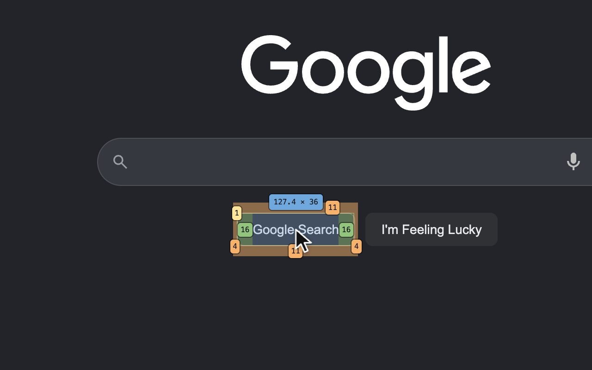
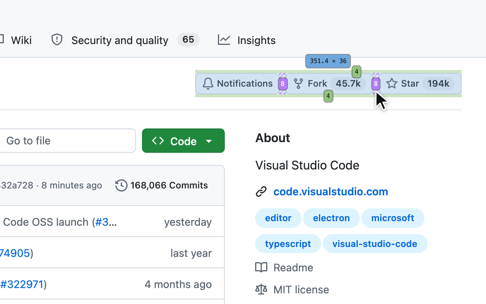
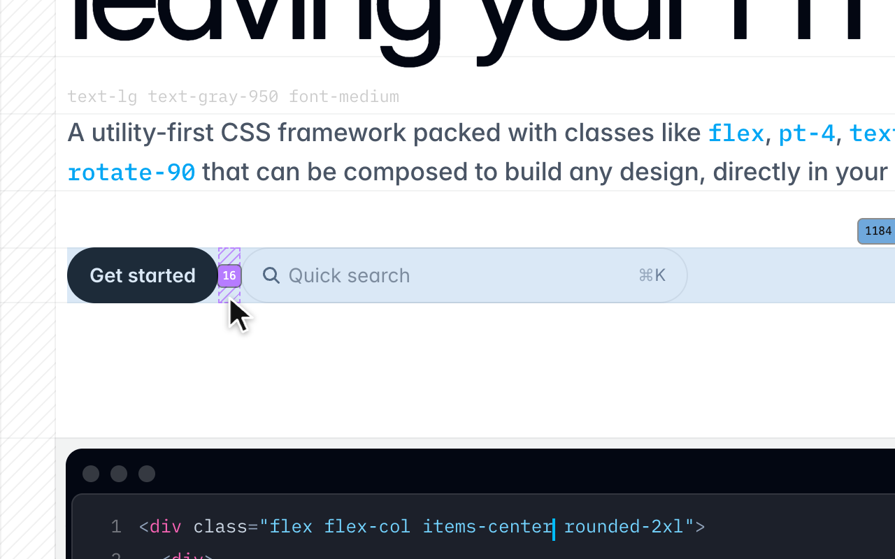

# Measure

  

**Hover any element on any page to see its margin, border, padding and size, a flex or grid gap, and where it sits.**

A Chrome extension. Each side's value sits on its band, a gap is hatched with its value, a positioned element shows its
offsets, and the size sits just above it. [See the site](https://zaydek.github.io/measure/).

## See it on

<table>
  <tr>
    <td width="50%"> <b>google.com</b>: the search box's padding, then each button's margin, border and size</td>
    <td width="50%"> <b>stripe.com</b>: a hero grid's 40 px row gaps, then the gap between two buttons</td>
  </tr>
  <tr>
    <td width="50%"> <b>google.com</b>: a button's margin, border and padding</td>
    <td width="50%"> <b>github.com</b>: the flex gap in a repo's button group</td>
  </tr>
  <tr>
    <td width="50%"> <b>stripe.com</b>: a grid's row gap, hatched</td>
    <td width="50%"> <b>tailwindcss.com</b>: the gap between two buttons</td>
  </tr>
  <tr>
    <td width="50%"> <b>apple.com</b>: a button's border, padding and size</td>
    <td width="50%"></td>
  </tr>
</table>

## Install

**[Add to Chrome](https://chromewebstore.google.com/detail/measure/dgikeobpapokgcfcamabaoojiejphnfk)**: free, from the Chrome Web Store.

## Use

- Toggle: **Option+Shift+M** (Alt+Shift+M on Windows and Linux), or click the toolbar icon. The icon reads "ON" on a tab
  where it is lit.
- Hover any element. A scroll under a still pointer measures what is under it now.
- **Escape** turns it off, and nothing of it stays on the page.
- Change the key at `chrome://extensions/shortcuts`. The options page (right-click the icon, then Options) shows the
  current key.

It runs only on the tab where you turn it on. Chrome keeps every extension out of `chrome://` pages and the Web Store.

## Privacy

Measure stores nothing and sends nothing anywhere. [PRIVACY.md](PRIVACY.md) says exactly what it reads.

## License

Free to install and use; all rights reserved. See [LICENSE](LICENSE).

The sites shown are their owners' trademarks, pictured only to show Measure working on them; none of them endorses or is
affiliated with Measure.
